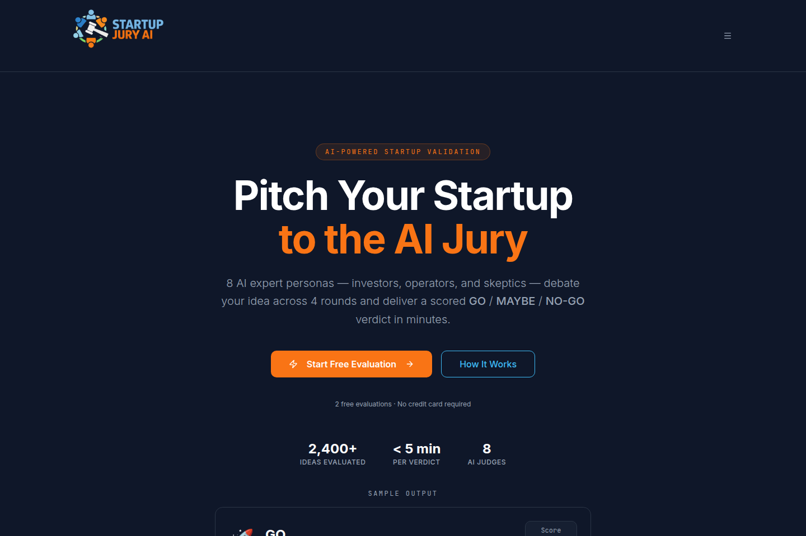
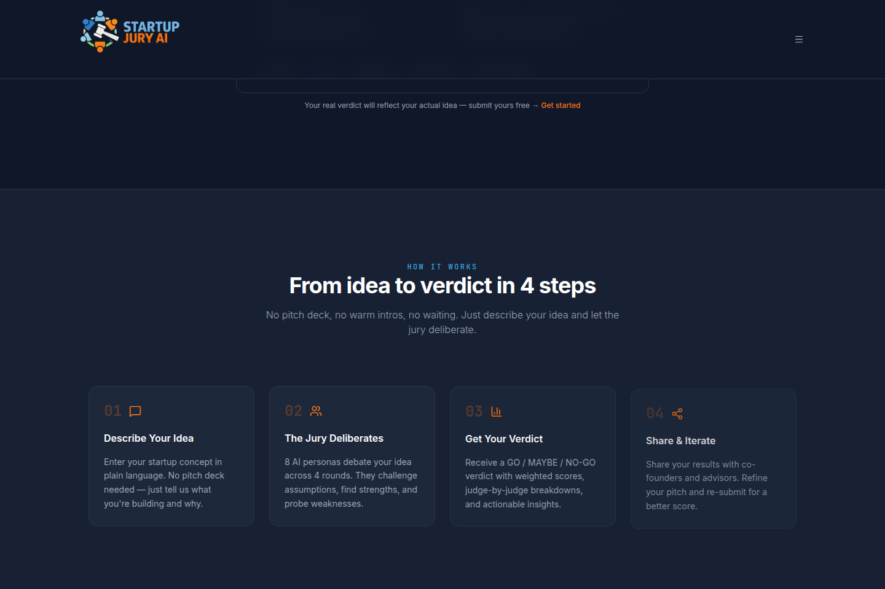
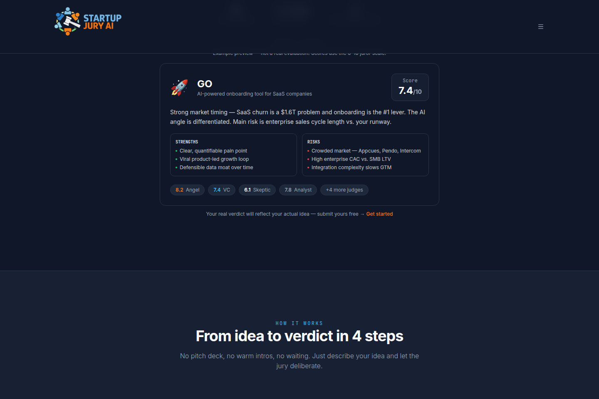
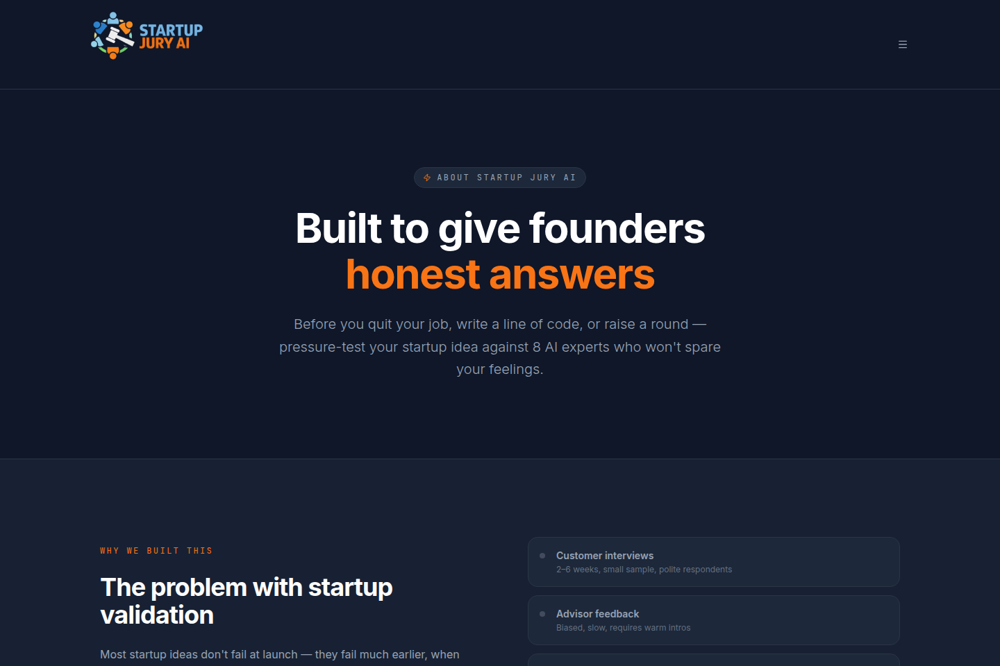
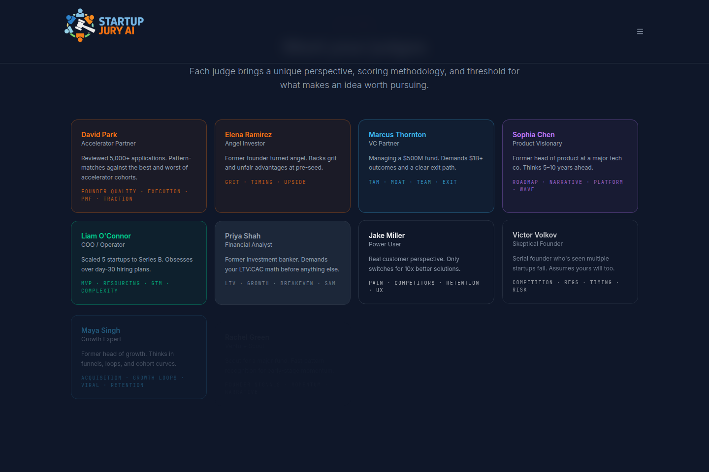
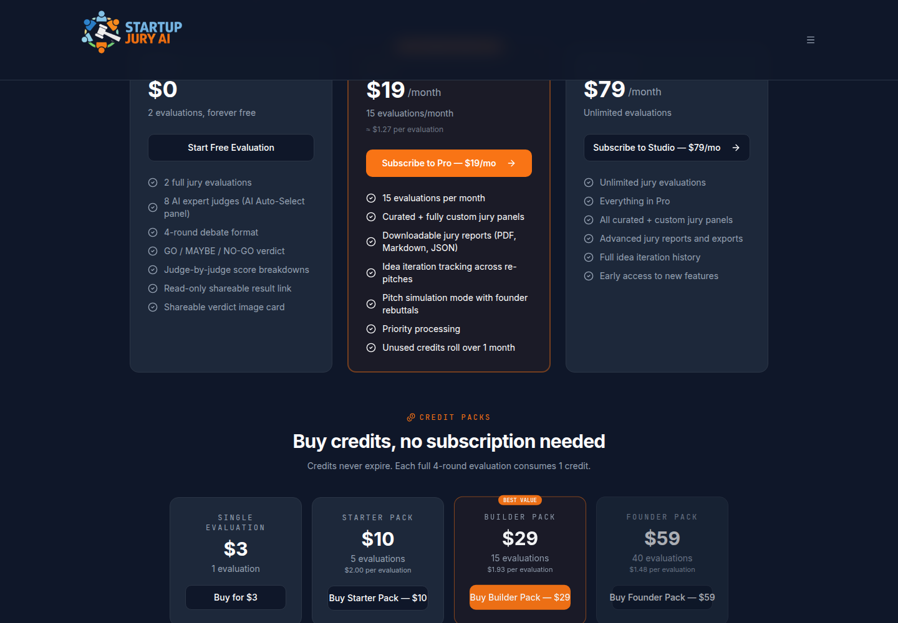
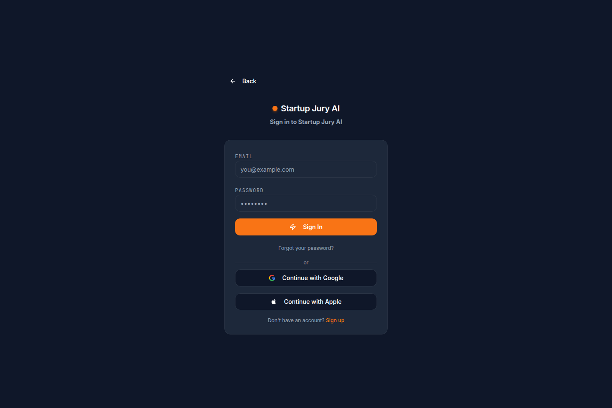
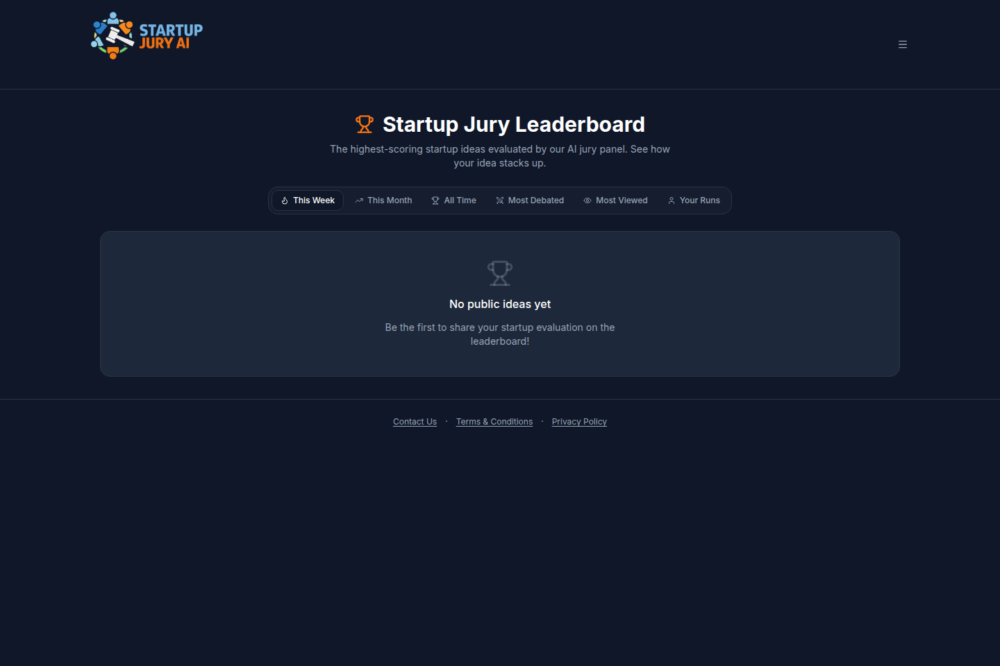

# Startup Jury AI

Startup Jury AI is a web app where a founder describes a startup idea and an AI jury debates it. Each seated juror has its own scoring weights. After four rounds the app asks for a consensus verdict of **GO**, **MAYBE**, or **NO-GO**, with per-juror scores, strengths, risks, and a next step.

The live site is [https://www.startupjuryai.com](https://www.startupjuryai.com) (`https://startupjuryai.com` redirects there).



The screenshots below are from this repository running locally (`bun run dev`) on 14 October 2026. The homepage “2,400+ ideas evaluated” figure and the sample verdict card are static copy in `src/pages/Landing.tsx`, not a count or a session loaded from the database.

## Features

These are implemented in the source, not a wishlist.

- **Idea form.** Problem and solution are required. Target market and monetization are optional. Each field accepts dictation through `VoiceInputButton` (an ElevenLabs scribe token from `src/lib/media.functions.ts`).
- **Jury of 16 built-in personas**, in `src/data/personas.ts`. A session seats eight. Four curated panels live in `src/data/panels.ts`: Investor, Product & Market, Startup Operator, and Accelerator Simulation. Auto-select asks the model to pick a panel id and falls back to keyword hints.
- **Custom panelists.** Signed-in users can create personas, upload a photo, import a library, and buy extra slots (`/panelists`).
- **Four rounds.** Round 1 is the first impression. The founder can answer between rounds, or turn on auto-debate and let the app draft the replies. Round 4 is the final statement and does not ask the founder another question. Juror prompts are capped at 500 words (`getWordLimit` in `src/lib/ai.ts`). Responses stream into the debate table, and an in-flight round can be cancelled.
- **Scores and verdict.** Each juror score is on a 0–10 scale with that persona’s weights (`src/types/debate.ts`). A consensus judge then returns GO / MAYBE / NO-GO, an average score, three strengths, two risks, praise, the sharpest critique, a next step, and a percentile.
- **Accounts.** Email and password, Google, and Apple (`src/pages/Auth.tsx`, via Lovable auth). Forgot-password and reset-password routes. Debate, dashboard, and panelists require a session.
- **Saved sessions.** The dashboard lists a user’s debates, filters in-progress and finished runs, and can resume or delete one. A re-pitch stores `parent_session_id` and `version`, and `VersionComparison` shows how the score moved.
- **Sharing.** A session can be private, anonymous, or public. Pro and Studio accounts (as reported by `useSubscription`) can download the transcript as Markdown, JSON, or PDF. There is also a read-only `/result/$id` link and social post copy.
- **Leaderboard.** Public sessions can be sorted by this week, this month, all time, score spread, and views, and visitors can cast a community vote. Compared locally against this project’s Supabase database, the board had no public ideas.









### Pricing as shown in the app

| Offer | Price in `src/data/pricing.ts` | What the page says you get |
| --- | --- | --- |
| Free | $0 | 2 evaluations |
| Pro | $19/month | 15 evaluations/month, custom panels, transcript export, re-pitch history |
| Studio | $79/month | Unlimited evaluations and the Pro features |
| Single evaluation | $3 | 1 credit |
| Starter pack | $10 | 5 credits |
| Builder pack | $29 | 15 credits |
| Founder pack | $59 | 40 credits |

Checkout and the customer portal are Stripe sessions created in `src/lib/billing.functions.ts`. A new account row is inserted with 2 credits. Round 1 spends one credit. If that generation fails, comes back empty, or is cancelled before it produces text, `/api/debate-ai` refunds it. Later rounds of the same session are not charged again.

The generation route skips the credit charge only when Stripe shows an active subscription on the **Pro** product. The Studio product is recognized by `checkSubscription` for the pricing UI, and it is not in that waiver. There is no code in this repo that adds 15 credits each month, and `syncPurchasedCredits` is never called from the UI. Treat the table above as the offer on the page. The charge path is the behavior above.







### Agent access

`/mcp` exposes five tools for the signed-in user: `list_debates`, `get_debate`, `list_panelists`, `create_panelist`, and `get_credit_balance`. Auth is Supabase OAuth (`src/lib/mcp/index.ts`).

## Tech stack

- React 19 and TypeScript
- Vite 8 and TanStack Start / TanStack Router (file routes in `src/routes`)
- Tailwind CSS 4 and shadcn/ui (Radix)
- Supabase: Auth, Postgres, Storage, and Edge Functions
- Stripe for checkout
- Nitro, emitting a Cloudflare Worker build
- Vitest and Testing Library
- Framer Motion
- Optional media: ElevenLabs (dictation and TTS) and Tavus (host video), both behind server secrets

Bun is the package manager this repo locks (`bun.lock`, `bunfig.toml`).

## Architecture

```text
Browser (TanStack Start)
  ├─ Supabase client ─ auth, debate_sessions, panelists, votes, credits
  ├─ POST /api/debate-ai ─ SSE juror text
  │     ├─ Supabase Auth (the caller’s JWT)
  │     ├─ service role ─ consume / refund one credit per session
  │     ├─ Stripe ─ Pro subscription check
  │     └─ Lovable AI gateway ─ allowlisted Gemini and GPT models
  ├─ server functions ─ billing, contact, public session meta, media
  └─ /mcp ─ OAuth tools for the signed-in user
```

`src/server.ts` wraps the TanStack server entry and turns a swallowed SSR 500 into an HTML error page. `src/lib/debateEndpoint.ts` posts to `/api/debate-ai`. A parallel `supabase/functions/debate-ai` edge function is still in the repo; the browser path used by `src/lib/ai.ts` is the app route. Other edge functions render crawler HTML for result pages (`og-result`) and send the contact form (`send-contact-email`).

Postgres tables created by `supabase/migrations` include `debate_sessions`, `user_credits`, `credit_charges`, `panelists`, `panelist_profiles`, `panelist_slots`, `leaderboard_votes`, `contact_messages`, `user_agreements`, and `analytics_events`.

`capacitor.config.ts` points a Capacitor shell at a Lovable preview URL. This repository is the website. A shipped iOS or Android binary is not part of the setup verified here.

The project is edited in Lovable, which commits to this repo. Pushing here can sync back. Do not rewrite git history to remove the previously committed `.env`; Lovable is synced to this history.

## Local setup

Verified with Bun 1.4.3 and Node.js 22.

1. Install [Bun](https://bun.sh) and Node.js 22.
2. Clone and install:

```sh
git clone https://github.com/shaythegay13/argument-arena.git
cd argument-arena
bun install
cp .env.example .env
```

3. Fill in `.env` from the Supabase project (Project Settings → API):

- `SUPABASE_URL` and `VITE_SUPABASE_URL` — project URL
- `SUPABASE_PROJECT_ID` and `VITE_SUPABASE_PROJECT_ID` — project ref
- `SUPABASE_PUBLISHABLE_KEY` and `VITE_SUPABASE_PUBLISHABLE_KEY` — publishable anon key

The publishable key is meant to be in the browser. Do not put the service-role key in `.env`.

4. Start the app. Vite prints the local URL. In the verification run that was `http://127.0.0.1:5173/`.

```sh
bun run dev
```

`bun run build` completes with the values above and also with a blank `.env` copied from `.env.example`. A blank file is enough to compile. Sign-in, saved debates, and a live jury need the Supabase values. A real debate also needs server secrets that are not in this repo: `SUPABASE_SERVICE_ROLE_KEY`, `STRIPE_SECRET_KEY`, and `LOVABLE_API_KEY`. Dictation, TTS, and host video additionally need `ELEVENLABS_API_KEY` or `ELEVENLABS_TTS_API_KEY`, `TAVUS_API_KEY`, and `TAVUS_REPLICA_ID`. Those are set in the hosted Lovable / Supabase environment.

`npm install` fails with `ERESOLVE`. `next-themes@0.3.0` declares a peer dependency of React 16–18, and this app uses React 19. Use Bun.

### Scripts

| Command | What it does |
| --- | --- |
| `bun run dev` | Vite dev server |
| `bun run build` | Production client and SSR build (Nitro / Cloudflare Worker output) |
| `bun run preview` | Preview the production build |
| `bun run test` | Vitest once |
| `bun run lint` | ESLint |

`bun run test` passed: 27 tests in `roundPrompts.test.ts`, `round4Flow.test.tsx`, and `siteHeader.test.tsx`.

## Contributors

From `git log`:

- **Shay Bouchles** (`shay.bouchles@gmail.com`) — 17 commits, including debate-generation fixes, session resume, SEO, and the About and Pricing pages.
- **Lovable** (`noreply@lovable.dev`) — the initial project template.
- **gpt-engineer-app[bot]** — 722 commits written from the Lovable editor.

## Public routes

| Path | Who can open it |
| --- | --- |
| `/` | Anyone. Landing page |
| `/about`, `/pricing`, `/contact`, `/terms`, `/privacy` | Anyone |
| `/leaderboard` | Anyone |
| `/auth`, `/forgot-password`, `/reset-password`, `/accept-terms` | Anyone |
| `/result/$id` | Shared result |
| `/debate`, `/dashboard`, `/panelists` | Signed-in users |
| `/api/debate-ai` | Signed-in jury generation |
| `/mcp` | Signed-in MCP tools |
